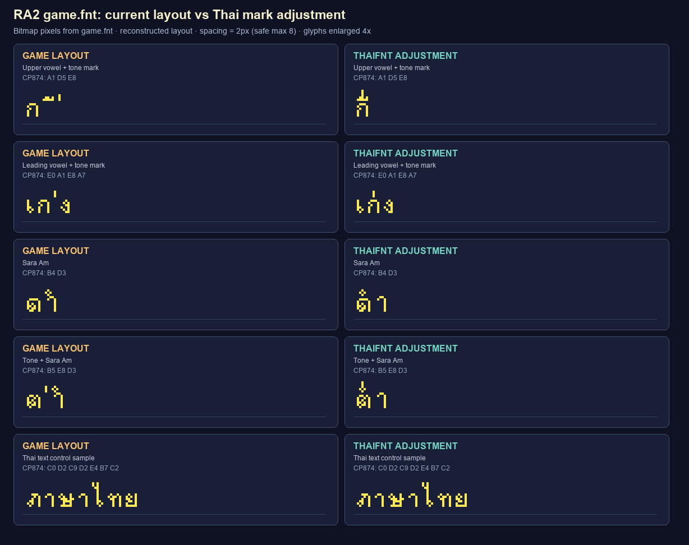

# Thai bitmap-font fix for RA2 / Yuri's Revenge

This project integrates the Thai combining-mark fix into CnCNet's TS-DDraw source. The resulting `ddraw.dll` is the renderer itself, so it does not forward DDraw exports through another proxy. It works with the local game DLL when starting directly or through Syringe/CnCNet.

This folder contains the DirectDraw integration, its small TS-DDraw integration patch, and CnCNet's TS-DDraw source as a Git submodule at `ddraw/ts-ddraw-upstream`. The shared font-hook implementation is in `shared/ThaiFontFix.cpp`; `ddraw/ThaiFontFix.cpp` remains as a compatibility include for the TS-DDraw patch. The submodule is pinned to commit `5c1394b699fd9b6e37ab84b993cab147044b41a9` from [CnCNet/ts-ddraw](https://github.com/CnCNet/ts-ddraw). This keeps upstream history separate while preserving the exact changes needed to build the integrated DLL.

The font hooks are called by TS-DDraw's `DirectDrawCreate` after the game executable is mapped and before TS-DDraw initializes its renderer. The fix makes a private in-process copy of parsed font data so it can adjust glyph advances even when the game's original font records are read-only. If the full runtime glyph-record range is inaccessible, it can read the loose `game.fnt` beside `ddraw.dll` after confirming the bitmap dimensions and all 256 CP874 glyph-map entries match the live font. It copies only records present in both tables, zero-fills the remaining unmapped tail, and rejects the fallback if any CP874 byte points outside the copied records. The game executable and `game.fnt` are never patched on disk.

## Build and install

1. After cloning this project, initialize the upstream source with `git submodule update --init ddraw/ts-ddraw-upstream` (or clone this repository with `--recurse-submodules`). The parent repository pins the upstream commit.
2. Run `./ddraw/build.ps1` from the project root. It applies `ddraw/patches/ts-ddraw-integration.patch` if needed and builds a 32-bit `ddraw/ddraw-integrated.dll` with the shared `ThaiFontFix.cpp` implementation.
3. Close RA2/Yuri's Revenge, including `RA2MD.exe`, `gamemd.exe`, and `game.exe`.
4. Run `./ddraw/install-integrated-ddraw.ps1`. By default, it installs into the parent game folder (the current repository layout); use `-GameDirectory <path>` for another game folder. It keeps the original renderer as `ddraw-custom.dll`. The Bink proxy can remain installed alongside it; the integrations share hook detection and the common INI.
5. Launch the game normally. TS-DDraw continues to read `ddraw.ini`.

To restore the original renderer, close the game and run `./ddraw/install-integrated-ddraw.ps1 -Restore`. The original remains in `ddraw-custom.dll`.

## Settings and diagnostics

The integrated DLL reads the shared `thaifontfix.ini` beside `ddraw.dll`:

```ini
[FontFix]
Enabled=1
CenterMarks=1
ToneMarkRaise=2
MaxExtraSpacing=8
DebugLog=1
```

`Enabled` toggles the fix. `CenterMarks` controls horizontal centering, `ToneMarkRaise` sets the vertical offset in pixels (0–16) for stacked marks, including a tone mark above Sara Am, and `MaxExtraSpacing` limits the font spacing handled by the fix (0–8). `DebugLog=1` writes `thaifontfix.log` beside the DLL. The Bink and Syringe builds read the same INI and append to the same log.

The log reports whether the hooks installed and then, on first use, whether the layout/render hooks were reached, whether a font's Thai mark glyphs were accepted, whether spacing allowed adjustment, and whether a Thai mark was handled. Sara Am stacking is reported as `tone mark stacked above Sara Am`. If file fallback is needed, it logs whether `game.fnt` matched and was loaded. `font hooks installed` only confirms that the entry points were patched; the runtime messages confirm whether the fix reached a Thai glyph. If `DebugLog=1` was enabled for the current run, share the full `thaifontfix.log` after opening a menu that displays Thai text.

## Supported builds and font data

The hook validates the executable PE timestamp, image size, renderer/layout signatures, font layout, and Thai mark glyph mappings before modifying process memory. It supports the supplied `game.exe` and `gamemd.exe` builds. Other executable builds keep rendering normally, but the Thai fix stays inactive until their addresses and signatures are analyzed.

The fix handles combining slots `D1`, `D4–D7`, `D8–DA`, and `E7–EE` in the supplied FNT font. It relies on the font containing glyphs in the expected CP874 slots; it does not add missing glyphs or convert Unicode text to CP874.

### Sara Am and tone marks

CP874 `D3` is the font's single Sara Am glyph. The game advances it as a normal glyph, but its bitmap contains two visual parts: the upper nikhahit dot and the lower/right Sara Aa body. When the bitmap passes the split checks, the hook draws the dot centered over the preceding base and draws the lower body at the game's normal baseline and advance. `D3` therefore remains a spacing glyph; it is not added to the zero-advance combining-mark set.

When a tone-mark byte immediately precedes `D3`, the hook holds that mark for one glyph. If the next glyph is Sara Am, it draws the Sara Am parts and then draws the tone mark above the nikhahit. If the next glyph is anything else, it flushes the tone mark with the normal mark placement. The vertical offset is controlled by `ToneMarkRaise`.

This placement matches the current Unicode Thai rendering guidance: when U+0E33 SARA AM follows a tone mark, its nikhahit component is displayed below the tone mark. The Unicode chart also lists the compatibility decomposition of U+0E33 as U+0E4D NIKHAHIT plus U+0E32 SARA AA. See [Unicode 18, Chapter 16, Thai combining marks](https://unicode.org/versions/Unicode18.0.0/core-spec/chapter-16/) and the [Unicode Thai character chart](https://www.unicode.org/Public/UCD/latest/charts/nameslist/0e00/).

The split is intentionally conservative: it requires the supplied font's compact upper dot and a long right-edge vertical stroke in the lower vowel. If a custom font has different Sara Am artwork or maps it to a different byte, the split may be rejected and the glyph is drawn unchanged. The preview below uses the actual `game.fnt` bitmap records; the right-hand panels show the fix's simulated placement.



Regenerate it from the project root with `python .\render_fnt_test.py --output .\thai-render-sara-am.png`. The `ต่ำ` row exercises tone-mark-plus-Sara-Am placement; `ดำ` exercises Sara Am without a tone mark. The preview models glyph placement from `game.fnt`; confirm behavior in the game as well because the preview does not execute the game renderer or DLL hook.

## DLL properties

The integrated DLL retains the original `ddraw.dll` filename and all TS-DDraw exports, and its Windows Details tab identifies it as `TS-DDraw with Thai bitmap-font mark placement fix`. The integration patch adds `ThaiFontFixIsActive` at ordinal 500 without shifting upstream exports; other ThaiFontFix loaders use it to avoid installing duplicate hooks.

## Sources

`ddraw/ts-ddraw-upstream` is the CnCNet TS-DDraw source checkout. The root `research-notes.md` records the executable analysis and FNT layout used by the hook.
